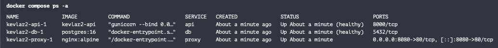
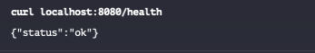
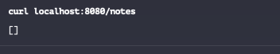
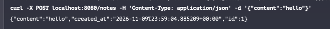
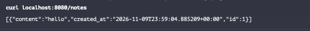
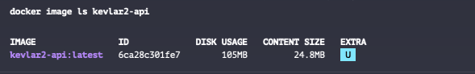
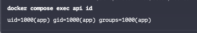
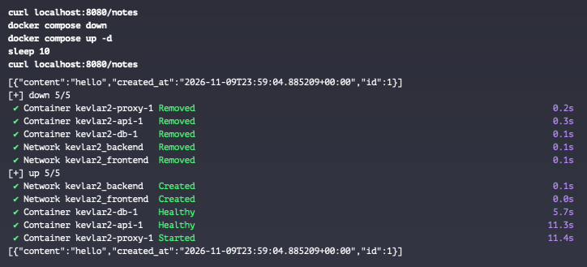
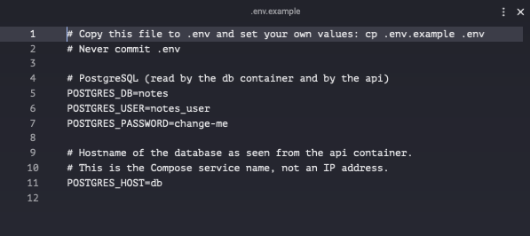
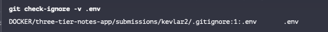

# Week 2: Containerise a 3-Tier App

A small Notes API, its PostgreSQL 16 database and an Nginx reverse proxy, packaged so the whole stack starts with one command.

```text
host :8080 ──► proxy (Nginx) ──► api (Flask + gunicorn) ──► db (PostgreSQL 16)
               └─ frontend network ─┘└──── backend network ────┘
```

## Quick start

```bash
cp .env.example .env        # then edit .env and set your own POSTGRES_PASSWORD
docker compose up -d --build
```

Then:

```bash
curl localhost:8080/health
curl localhost:8080/notes
curl -X POST localhost:8080/notes \
  -H 'Content-Type: application/json' \
  -d '{"content":"hello"}'
```

Stop the stack with `docker compose down`. This keeps your notes. `docker compose down -v` also deletes the database volume.

## API

| Endpoint | Description |
| --- | --- |
| `GET /health` | `200 {"status":"ok"}` when the API can reach the database, otherwise `503` |
| `GET /notes` | List all saved notes |
| `POST /notes` | Create a note from `{"content": "..."}`. Returns `201`, or `400` if `content` is empty |

The API (`api/app.py`) is deliberately small. It creates the `notes` table itself on start-up, so no manual database setup is needed. The API was written with AI assistance, which the task allows.

## Configuration

Credentials come from a local `.env` file. `.env` is git-ignored and `.env.example` is committed with placeholder values.

| Variable | Used by | Purpose |
| --- | --- | --- |
| `POSTGRES_DB` | `db`, `api` | Database name |
| `POSTGRES_USER` | `db`, `api` | Database user |
| `POSTGRES_PASSWORD` | `db`, `api` | Database password. Set your own |
| `POSTGRES_HOST` | `api` | Database host. Must be the Compose service name `db` |

The `postgres:16` image only reads these on first start, when the data volume is empty. If you change the password later, run `docker compose down -v` to recreate the database.

## Design decisions

- **Three services only:** `proxy`, `api` and `db`. They find each other by service name, never by IP address.
- **Only the proxy is published**, as `8080:80`. `api` and `db` have no `ports:` section, so they are reachable only from inside Docker networks.
- **Two networks:** `frontend` has `proxy` and `api`. `backend` has `api` and `db`. The API bridges them, and the proxy cannot resolve or reach the database.
- **Multi-stage API image:** a builder stage installs the Python dependencies, and the final stage copies in only the installed packages and `app.py`. No build cache or pip cache ends up in the final image. It is based on `python:3.12-alpine` and is **105 MB**, under the 200 MB limit.
- **Non-root user:** the API container runs as `app` (uid 1000), not root.
- **No secrets in the image:** credentials are passed at runtime through `env_file`. `.dockerignore` keeps `.env`, `.git` and the evidence out of the build context.
- **Health checks and start-up order:**
  - `db` uses `pg_isready -h 127.0.0.1 -U $POSTGRES_USER -d $POSTGRES_DB`. The `-h 127.0.0.1` forces a TCP check. Without it the check can pass against the temporary Unix-socket server that Postgres runs during first-time initialisation, before it accepts TCP connections.
  - `api` has a Dockerfile `HEALTHCHECK` that calls `/health` using Python's standard library, so there is no need to install `curl` in the image.
  - `api` waits for `db` to be healthy, and `proxy` waits for `api` to be healthy (`depends_on` with `condition: service_healthy`).
- **Persistence:** PostgreSQL data lives in the named volume `postgres_data`.

## Evidence

All screenshots are in [`evidence/`](evidence/).

### 1. Services running and healthy

`docker compose ps` shows all three services up, with `api` and `db` healthy. The build and start-up output is in [`00-compose-up-build.png`](evidence/00-compose-up-build.png).



### 2. API through Nginx






### 3. Only the proxy is published

In the `docker compose ps` screenshot above, only `proxy` shows a host mapping (`0.0.0.0:8080->80/tcp`). `api` shows `8000/tcp` and `db` shows `5432/tcp`, which are internal container ports with no host mapping.

### 4. Image size and non-root user

The API image is 105 MB and the container runs as `app` (uid 1000).




### 5. Network isolation

[`05a-networks-inspect.txt`](evidence/05a-networks-inspect.txt) shows `frontend` contains `api` and `proxy`, and `backend` contains `api` and `db`. The proxy is not on `backend`, so it cannot resolve the database name:


### 6. Persistence

A note is created, then the stack is taken down with `docker compose down` (without `-v`) and brought back with `docker compose up -d`. The same note, with the same id, is still returned.



### 7. Configuration

`.env.example` is committed with placeholder values, and `.env` is ignored by git.




<!-- TODO: add the fresh-clone run (07c-fresh-clone.png) once the branch is pushed -->

## Problems encountered and how I solved them

- **API container never became healthy.** The port was inconsistent: the health check called 8080, `EXPOSE` said 8080, but gunicorn listened on 8000. I used 8000 in all three places and in the Nginx `proxy_pass`.
- **API container would not start.** I had passed `--host` and `--port` to gunicorn, which does not have those options. The correct flag is `--bind 0.0.0.0:8000`.
- **The database health check never passed.** `pg_isready -d` had no database name after the flag, so the command always errored. I passed `$POSTGRES_DB` through the container environment (written `$${POSTGRES_DB}` in Compose so Compose does not expand it) and added `-h 127.0.0.1`.
- **Networks and published ports did not match the brief.** I first had three networks and had published ports on `api` and `db`. I reduced it to `frontend` and `backend` and removed the extra `ports:` entries so only the proxy is exposed.

## What I learnt

- **Writing and building the Dockerfile.** I wrote a multi-stage Dockerfile and fixed the build problems one at a time as I went. Reading each build error and tracing it back to the line that caused it taught me more than getting it right first time would have.
- **Building the Compose file and troubleshooting the networking.** I built the Compose file and had to work through network problems. That showed me how Compose networks, service names and `depends_on` health conditions fit together, and how to prove isolation with `docker network inspect` and a failed name lookup from the proxy.

## Project layout

```text
submissions/kevlar2/
├── README.md
├── docker-compose.yml
├── Dockerfile
├── .dockerignore
├── .gitignore
├── .env.example
├── nginx/nginx.conf
├── api/
│   ├── app.py
│   └── requirements.txt
└── evidence/
```
