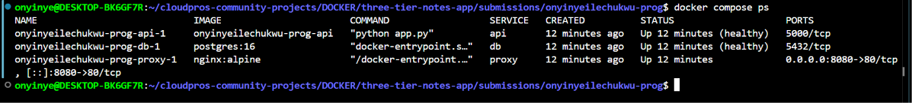
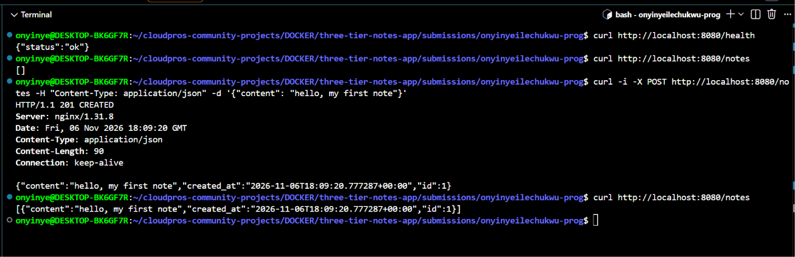
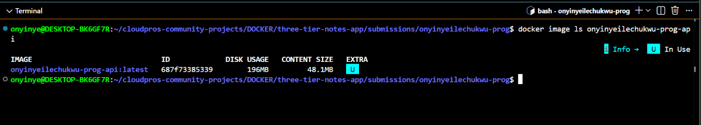
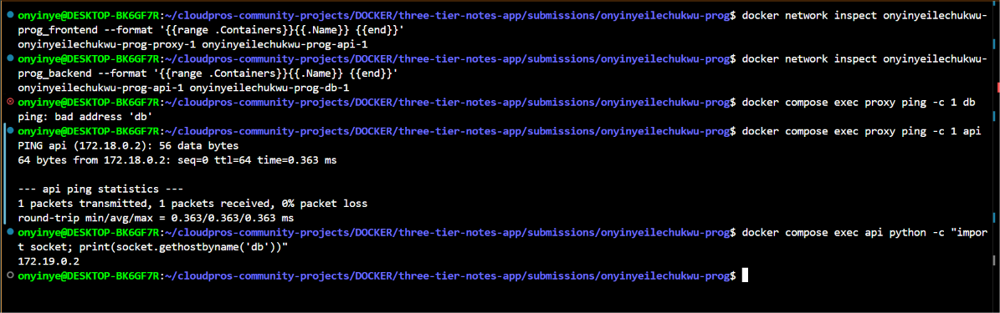
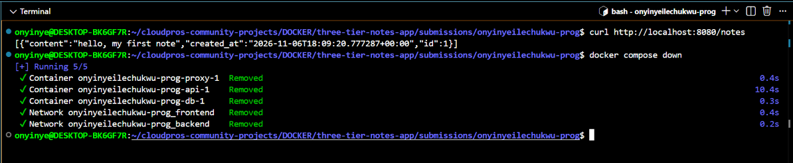
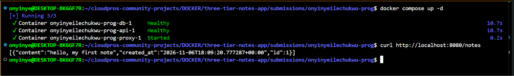
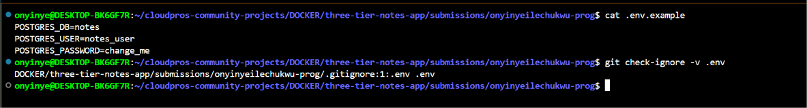
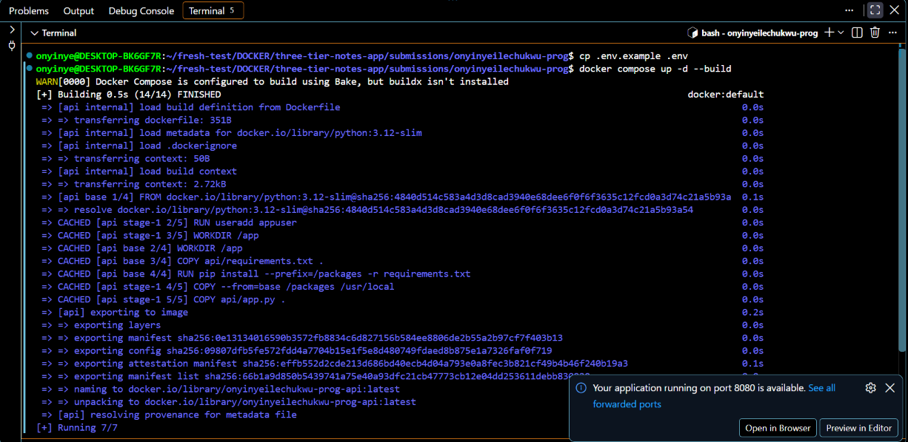
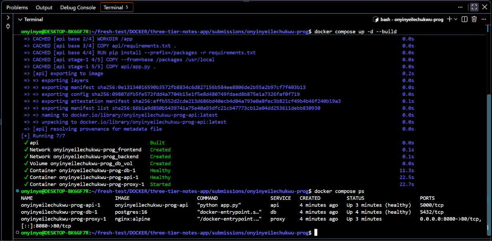
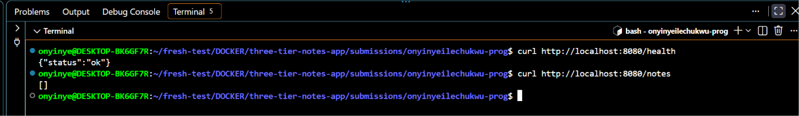

# Three-Tier Notes App

A notes app run with Docker Compose. It has three services:

- `proxy`: Nginx. It is the only service open on the host (port 8080).
- `api`: Python Flask. It stores and reads notes.
- `db`: PostgreSQL 16. It keeps the notes in a named volume.

## Setup

You need Docker and Docker Compose.

```bash
cp .env.example .env
docker compose up -d --build
```

Check it:

```bash
docker compose ps
curl http://localhost:8080/health
```

Stop it and keep the data: `docker compose down`. Do not use `-v` unless you want to delete the data.

## Environment variables

Set these in your own `.env` file. `.env` is ignored by Git. `.env.example` is committed with safe example values.

| Variable | Meaning | Example |
|---|---|---|
| `POSTGRES_DB` | Database name | `notes` |
| `POSTGRES_USER` | Database user | `notes_user` |
| `POSTGRES_PASSWORD` | Database password | `change_me` |

PostgreSQL sets the password only when the volume is first created. If you change the password later, run `docker compose down -v` first (this deletes the data).

## API

All requests go through Nginx on port 8080.

- `GET /health`: checks the API and the database.
- `GET /notes`: lists the notes.
- `POST /notes`: creates a note from `{"content": "..."}`.

The `notes` table is created automatically when the API starts.

## Design decisions

- **Service names:** Nginx sends requests to `http://api:5000` and the API connects to `db`. I use service names, not IP addresses.
- **Two networks:** `frontend` has `proxy` and `api`. `backend` has `api` and `db`. The `proxy` is not on `backend`, so it cannot reach the database.
- **One published port:** only `proxy` has `ports` (`8080:80`). `api` and `db` have none.
- **Health checks:** `db` uses `pg_isready`. `api` calls its own `/health`. `api` waits for `db` to be healthy, and `proxy` waits for `api` to be healthy (`depends_on` with `condition: service_healthy`).
- **Named volume:** `db_vol` is mounted at `/var/lib/postgresql/data`, so notes survive `down` and `up`.
- **Credentials:** `api` and `db` load `.env` with `env_file`. No secrets are in the image or in Git.
- **Nginx config:** `nginx/nginx.conf` is mounted read-only at `/etc/nginx/conf.d/default.conf`.

## Multi-stage build and non-root user

- **Multi-stage:** stage one installs the Python packages into `/packages`. The final stage starts from a clean `python:3.12-slim` and copies only `/packages` and `app.py`. Files from stage one, such as pip downloads, are not in the final image.
- **Non-root user:** the `Dockerfile` creates `appuser` and switches to it with `USER appuser`. If someone breaks into the app, they do not have root rights.
- **Size:** the final API image is **196 MB**, which is under the 200 MB limit.


**1. Services and health:** all three services run, and `db` and `api` are healthy.



**2. API through Nginx:** `/health` returned `ok`, `/notes` returned `[]`, `POST /notes` returned `201`, and the note was listed.



**3. Ports:** only `proxy` is published (`0.0.0.0:8080->80/tcp`).


**4. Image size:** the API image is 196 MB.



**5. Network isolation:** `frontend` has `proxy` and `api`. `backend` has `api` and `db`. From `proxy`, `ping db` fails, and `ping api` works. From `api`, `db` resolves.



**6. Persistence:** the same note was listed before `docker compose down` and after `docker compose up -d`.





**7. Configuration:** `.env.example` is committed and `.env` is ignored by Git.



**Fresh clone:** I cloned my branch into a new empty folder (no `.env`, no old volume). I ran `cp .env.example .env` and `docker compose up -d --build`. All services started, `/health` returned `ok`, and `/notes` returned `[]`, so the table was created automatically. Before the test I ran `docker compose down -v` to remove the old volume.





## Problems and fixes

- **`Temporary failure in name resolution` during `pip install`.** My computer had internet, but containers could not resolve names. I fixed it by adding `{"dns": ["8.8.8.8", "1.1.1.1"]}` to `/etc/docker/daemon.json` and restarting Docker with `sudo systemctl restart docker`.

