# Week 3: ShopLite Server Toolkit

Secure shared access, Nginx, two Bash tools (`sysreport.sh` and `logscan.sh`), scheduled reporting and log rotation for ShopLite's first Ubuntu server.

## Environment

| | |
| --- | --- |
| Host | macOS on Apple Silicon (arm64) |
| Server | Ubuntu 24.04.5 LTS (aarch64) in a [Multipass](https://canonical.com/multipass) VM named `shoplite` |
| Shell | GNU Bash 5.2.21 |
| Init system | systemd (`systemctl` and `journalctl` available) |

macOS cannot run `apt`, Linux ACLs or `journalctl`, so everything Linux-specific runs inside the VM:

```bash
multipass shell shoplite
```

Scripts and config are edited on the Mac, in this folder, and copied into the VM for testing.

Install the packages the task needs:

```bash
sudo apt update
sudo apt install -y nginx acl cron logrotate shellcheck
```

## Layout

```text
submissions/kevlar2/
├── README.md
├── scripts/
│   ├── sysreport.sh
│   └── logscan.sh
├── cron/
│   └── shoplite.cron
├── logrotate/
│   └── shoplite
└── evidence/
```

## 1. Shared ShopLite directory and permissions

### Create the group and users

```bash
sudo groupadd shopops
sudo useradd ava -g shopops
sudo useradd tom -g shopops
```

`-g shopops` makes `shopops` each user's **primary group**, so files they create are owned by group `shopops` by default.

Verify:

```bash
id ava && id tom && getent group shopops
```

```text
uid=1001(ava) gid=1001(shopops) groups=1001(shopops)
uid=1002(tom) gid=1001(shopops) groups=1001(shopops)
shopops:x:1001:
```

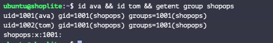

### Shared directory `/srv/shoplite`

Created as root, then the group and mode are set step by step:

```bash
sudo mkdir /srv/shoplite
sudo chgrp -R shopops /srv/shoplite
sudo chmod -R 2770 /srv/shoplite
```

The directory after each step (`ls -l /srv`):

```text
# 1. just created: owned by root:root, readable by everyone
drwxr-xr-x 2 root root    4096 Nov 21 18:48 shoplite

# 2. after chgrp: group is now shopops
drwxr-xr-x 2 root shopops 4096 Nov 21 18:48 shoplite

# 3. after chmod 2770: setgid bit set (the "s"), no access for others
drwxrws--- 2 root shopops 4096 Nov 21 18:48 shoplite
```

What `2770` means:

| Digit | Meaning |
| --- | --- |
| `2` | **setgid** on the directory, so new files and folders inherit group `shopops` |
| `7` | owner (root): read, write, execute |
| `7` | group (`shopops`): read, write, execute |
| `0` | others: no access, so a non-member cannot list or enter the directory |

**Non-member test.** `ubuntu` is not in `shopops`, so it is the outsider. Run without `sudo` (root would bypass permissions). Both listing and entering the directory are refused:

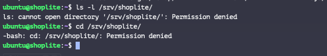

**Group write on new files (default ACL).** Setgid gives new files the right *group*, but not group *write*: `ava`'s default `umask` (022) makes her files `rw-r--r--`, so `tom` could read them but not edit them. A default ACL on the directory fixes this for every file created from now on:

```bash
sudo apt update && sudo apt install -y acl     # setfacl was not installed in the VM image
sudo setfacl -d -m g:shopops:rwx /srv/shoplite
```

`getfacl /srv/shoplite`:

```text
# file: srv/shoplite/
# owner: root
# group: shopops
# flags: -s-
user::rwx
group::rwx
other::---
default:user::rwx
default:group::rwx
default:group:shopops:rwx
default:mask::rwx
default:other::---
```

- `flags: -s-` is the setgid bit.
- `other::---` and `default:other::---` mean outsiders get nothing, now and on new files.
- The `default:` lines are inherited by every new file and folder.

**Testing as the group members.** Members are tested with `sudo -u ava ...` and `sudo -u tom ...` (they have no passwords). Results:

| Step | Result |
| --- | --- |
| `ava` creates `test.txt`, `tom` writes `Test 1` into it | works |
| `ava` and `tom` both read `test.txt` | both print `Test 1` |
| `tom` creates `test-tom.txt`, `ava` writes `Test 2` into it | works |
| `ava` and `tom` both read `test-tom.txt` | both print `Test 2` |
| `ubuntu` (not in `shopops`) reads `test.txt` or writes `test-tom.txt` | `Permission denied` |

**Evidence for requirement 1.** `ls -ld` shows the directory as `drwxrws---+` (setgid, no access for others, ACL present). `ava` creates `from-ava.txt`, `tom` appends to it, and `ava` reads back `edited by tom`. Every file in the directory is `rw-rw----+` with group `shopops`.

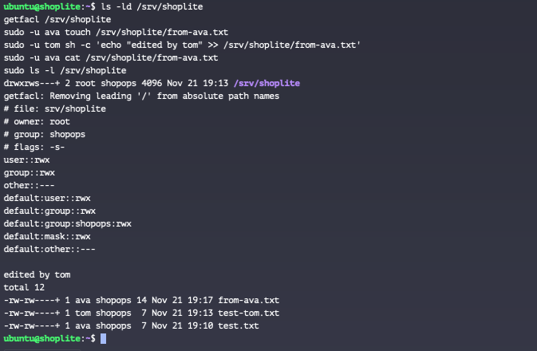

### Design decisions

- **Setgid (`2`) on the directory** so files and folders created inside always belong to group `shopops`, whoever creates them.
- **Default ACL** so those new files are group-writable and members can edit each other's work. This is more reliable than asking everyone to set `umask 002`, because it is enforced on the directory itself.
- **Mode `770`, never world-writable.** Others have no access at all, so non-members cannot list or enter `/srv/shoplite`.
- **Group-based, not user-based.** Anyone added to `shopops` later gets the same access with no change to the directory.


## 2. Nginx

Installed from the Ubuntu `apt` repository (version 1.24.0) and set to start now and on every boot:

```bash
sudo apt install -y nginx
sudo systemctl enable --now nginx
```

On Ubuntu, `enable` prints `Synchronizing state of nginx.service with SysV service script...`. This is normal: the package ships both a systemd unit and a legacy init script, and systemd syncs the two.

Verify the service and the HTTP response:

```bash
systemctl status nginx --no-pager
curl -I localhost
ss -tulnp
systemctl list-units --type=service *nginx*
```

- `systemctl status` shows `active (running)` and `enabled`, with a master process and two workers.
- `curl -I localhost` returns `HTTP/1.1 200 OK` from `nginx/1.24.0 (Ubuntu)`. `Content-Length: 615` is the size of Nginx's stock welcome page.
- `ss -tulnp` shows Nginx listening on port 80 on both IPv4 (`0.0.0.0:80`) and IPv6 (`[::]:80`). Port 22 is SSH. The `Process` column is empty because the command was run without `sudo`.

- `systemctl list-units --type=service *nginx*` lists `nginx.service` as `loaded active running`.

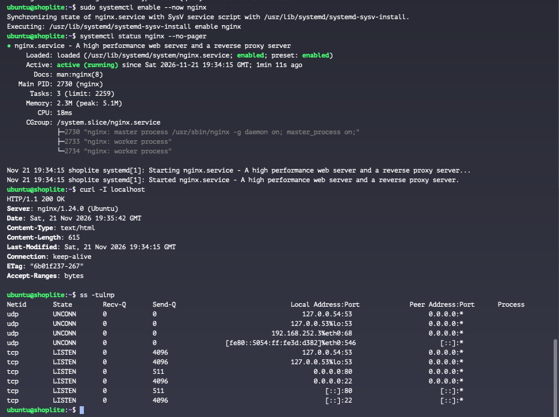

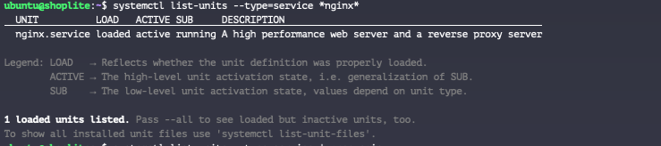

The default page itself is served. The `<title>` is Nginx's stock welcome page:

```bash
curl -s localhost | grep -i '<title>'
```

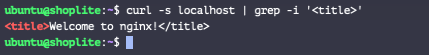

## 3. `sysreport.sh`

A one-command health report. It prints to the screen and saves the same text to `/var/log/shoplite/sysreport-<date>_<time>.log` (for example `sysreport-2026-11-21_22-43-58.log`).

```bash
sudo ./sysreport.sh
```

It needs root, because it writes to `/var/log/shoplite` and reads the systemd journal.

### What it reports

| # | Section | How |
| --- | --- | --- |
| 1 | Hostname and uptime | `hostname -f`, `uptime -p` |
| 2 | Load average (1, 5, 15 min) | `/proc/loadavg` |
| 3 | Memory used, total and percent | `free -m` + `awk` |
| 4 | Filesystems over 80% | `df -hP` (tmpfs, devtmpfs and squashfs excluded) + `awk` |
| 5 | Top 5 processes by memory | `ps --sort=-%mem` |
| 6 | Failed systemd units | `systemctl --failed` |
| 7 | Failed SSH logins in the last 24 hours | `journalctl -u ssh -u sshd --since "24 hours ago"`, falling back to `/var/log/auth.log` |

Sections that find nothing say so (`OK: No failed systemd units found.`) instead of staying blank, so an empty section never looks like a broken one.

### Test results

Normal run (as root), on screen:

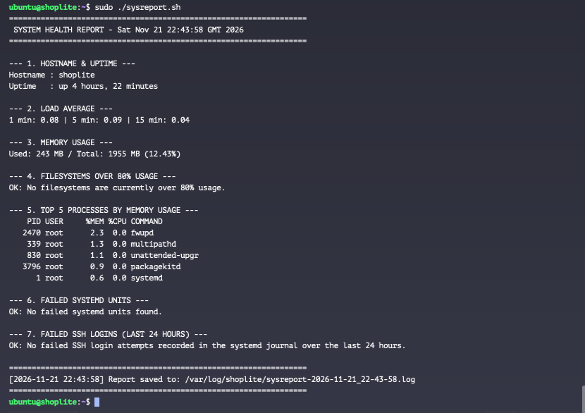

Every run creates its own timestamped file, owned by root and readable by all (`rw-r--r--`):

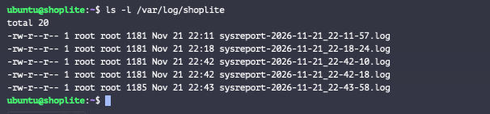

The saved files hold the same report text as the screen:

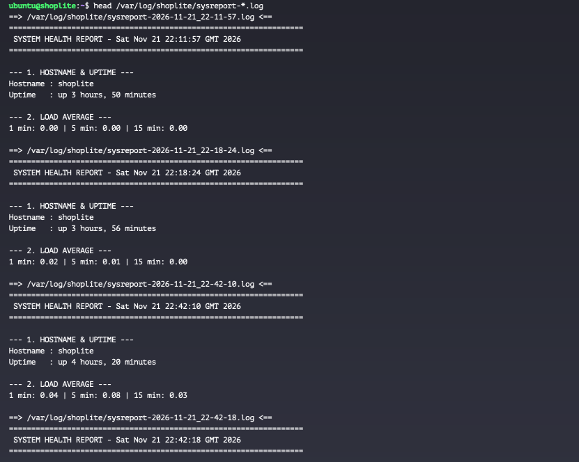

Failure paths:

```text
$ ./sysreport.sh                  # without sudo
[2026-11-21 22:11:47] ERROR: cannot write to /var/log/shoplite. Please run with sudo or as root.
$ echo $?
1

$ ./sysreport.sh -x               # unknown option
[2026-11-21 22:09:31] ERROR: unknown option '-x'
Usage: sysreport.sh
  Prints a system health report and saves a copy to /var/log/shoplite/.
  This script takes no options.
$ echo $?
2
```

### Design decisions

- **Check the log directory first.** My first version only ran `mkdir -p`, which succeeds when the directory already exists, so a non-root run printed a full report and then a false `Report saved to: ...` line even though `tee` had failed. The script now tests that `/var/log/shoplite` is writable before it prints anything.
- **One function per section.** `build_report` calls them in order and `main` pipes the result to `tee`. A new check is one new function and one new line.
- **`|| true` on the SSH greps.** `grep` exits 1 when it finds nothing, which `set -e` treats as a failure. On a quiet server that would kill the script, so "no matches" is handled on purpose.
- **`sed -n '1,6p'` instead of `head -n 6`.** With `pipefail`, `head` closing the pipe early can make the pipeline report a failure. `sed` reads all its input, so it cannot.

## 4. `logscan.sh`

Analyses an Nginx combined-format access log and prints a traffic summary.

```bash
./logscan.sh [-f FILE] [-n N] [-s STATUS] [-h]
```

| Option | Meaning | Default |
| --- | --- | --- |
| `-f FILE` | Log file to read | `/var/log/nginx/access.log` |
| `-n N` | How many entries to show in the top lists (positive integer) | `5` |
| `-s STATUS` | Only count requests with this HTTP status (e.g. `404`) | all statuses |
| `-h` | Show usage and exit 0 | |

The report has five parts: total requests, counts per status code, top client IPs, top URLs, and the number of 5xx responses. With `-s`, **all** of them (totals, rankings and the 5xx count) use only the filtered requests.

### Test data

The test data comes from real requests to the Nginx server in the VM, made with `curl`:

```bash
for i in 1 2 3 4 5 6; do curl -s -o /dev/null localhost/; done       # 200s
for p in missing about admin login; do curl -s -o /dev/null localhost/$p; done   # 404s
curl -s -o /dev/null -X POST localhost/                              # 405
curl -s -o /dev/null http://127.0.0.1/ ; curl -s -o /dev/null http://127.0.0.1/about   # second client IP
```

The default Nginx site never returns a 5xx, so I added a temporary route (`location = /boom { return 500; }`) to the default server block, requested it once, and removed it again.

### Test results

`./logscan.sh -n 3` on the real access log (23 requests: 11 × `200`, 10 × `404`, 1 × `405`, 1 × `500`). The status counts add up to the total, and the IP counts (21 + 2) do too:

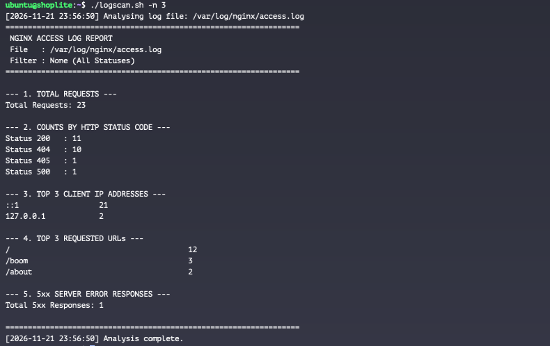

`./logscan.sh -s 404` filters everything to the 10 `404` responses, so the 5xx count correctly drops to 0:

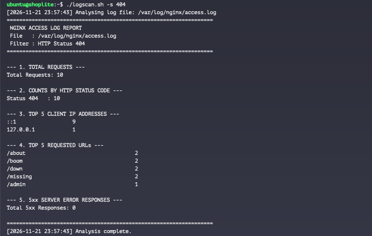

Error handling: an unknown option exits **2**, a missing input file exits **1**, and `-h` exits **0**:

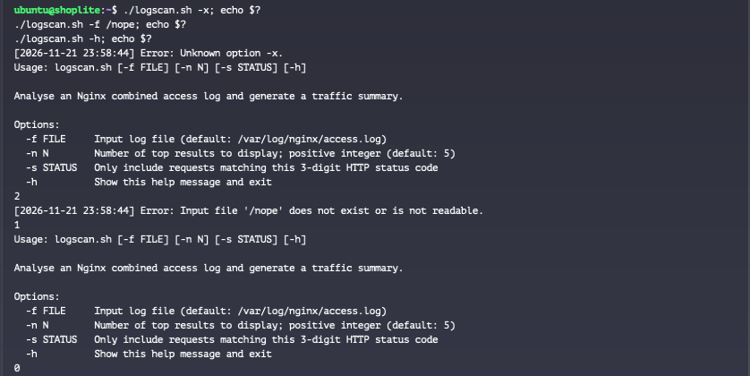

### Design decisions

- **One parsing step.** `extract_filtered_records` runs `awk` once over the file and produces `IP<TAB>URL<TAB>STATUS`, applying the `-s` filter there. Every part of the report reads that same data, so the filter is applied consistently by construction.
- **Request and status are parsed by position, not by splitting on spaces.** The URL comes from the quoted request string and the status is the first field after it, so user agents with spaces cannot shift the columns.
- **Input is validated before any work.** `-n` must match `^[1-9][0-9]*$`, `-s` must be a three-digit code, and `-f` must be a readable file. Bad values exit 2 (bad usage) and a missing file exits 1.
- **No `head` in the top-N pipelines.** My first version used `sort | head -n N`. On a 200,000-request test log it stopped silently with exit 141, because `head` closes the pipe, `sort` gets SIGPIPE, and `pipefail` plus `set -e` treat that as a failure. The report lost its last section and never said so. Replacing `head` with an `awk 'NR<=n'` stage fixed it. A 4-request test log would never have shown this.
- **Stable ordering.** Ties in the rankings are sorted by name, so the same log always gives the same report.

## 5. Script standards (both scripts)

| Standard | `sysreport.sh` | `logscan.sh` |
| --- | --- | --- |
| `set -euo pipefail` | Line 2 | Line 2 |
| Functions | One per report section, plus `usage`, `log`, `parse_args`, `ensure_log_dir`, `main` | `parse_args`, `validate_inputs`, `extract_filtered_records`, `print_report`, `usage`, `log`, `main` |
| Timestamped `log()` | `[YYYY-MM-DD HH:MM:SS] message` | same format (to stderr, so it never mixes into piped report output) |
| Unknown option | Usage on stderr, exit **2** | Usage on stderr, exit **2** |
| Missing or unwritable input | Error on stderr, exit **1** | Missing `-f` file: error on stderr, exit **1** |
| Success | Exit **0** | Exit **0**, and `-h` exits **0** |
| shellcheck | No findings | No findings |

shellcheck 0.9.0, run inside the VM on each script (no output and exit code `0` means clean):

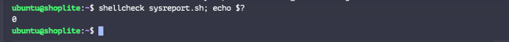


## 6. Cron: reporting and cleanup

Two jobs in [cron/shoplite.cron](cron/shoplite.cron), installed in **root's crontab**:

```text
SHELL=/bin/bash
PATH=/usr/local/sbin:/usr/local/bin:/sbin:/bin:/usr/sbin:/usr/bin

# Run sysreport.sh every 6 hours (at 00:00, 06:00, 12:00, and 18:00)
0 */6 * * * /usr/local/bin/sysreport.sh >/dev/null 2>>/var/log/sysreport-cron.log

# Daily at 03:15: selectively delete sysreport reports older than 14 days
# (the trailing * also matches logrotate's renamed copies: .log.1, .log.1.gz)
15 3 * * * /usr/bin/find /var/log/shoplite -maxdepth 1 -type f -name 'sysreport-*.log*' -mtime +14 -delete
```

### Install

```bash
sudo crontab -l                                    # "no crontab for root": safe, nothing to overwrite
sudo install -o root -g root -m 755 sysreport.sh /usr/local/bin/sysreport.sh
sudo crontab cron/shoplite.cron
sudo crontab -l
```

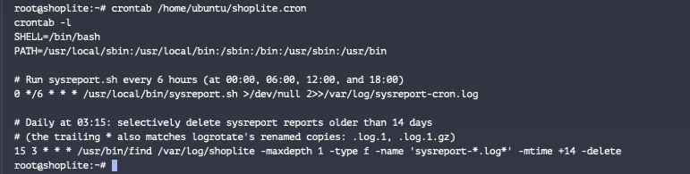

### Which account runs the jobs, and why

**root.** `/var/log/shoplite` is owned by `root:root` with mode `755`, so only root can write reports there, and `sysreport.sh` itself refuses to run if it cannot write to the directory. Root can also read the systemd journal, which the SSH-failure check needs. The same account runs the cleanup, so it is allowed to delete the files root created.

Running the jobs as `ava` or `tom` would need extra permissions on the log directory and the journal for no benefit. The script is installed as root-owned and not writable by others (`755`), because a job that runs as root must not run a file that anyone else could edit.

### How the cron test was done

Waiting six hours to see a run is not practical, so I temporarily added an every-minute entry, watched cron run it, and restored the real schedule straight away.

```bash
# temporary: add an every-minute copy of the report job
(crontab -l; echo '* * * * * /usr/local/bin/sysreport.sh >/dev/null 2>>/var/log/sysreport-cron.log') | crontab -

# after about 2 minutes: new reports, cron's own log, and the error log
ls -l /var/log/shoplite
journalctl -u cron --since "5 minutes ago" --no-pager | tail
cat /var/log/sysreport-cron.log

# restore the real schedule straight away
crontab /home/ubuntu/shoplite.cron
crontab -l
```

The journal shows cron running the exact command as root, new timestamped files appeared once a minute, and the error log stayed empty:

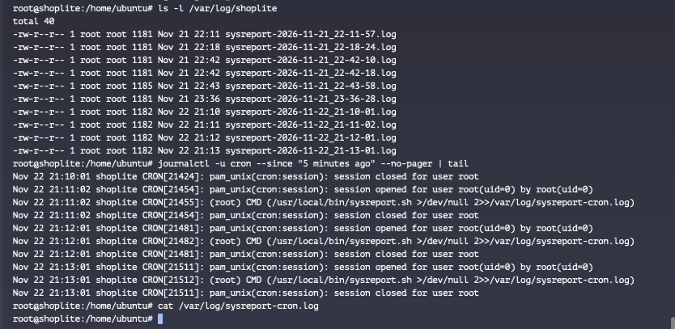

The cleanup was checked as a dry run first (`find ... -print` instead of `-delete`). It listed nothing, because every report was less than a day old.

### Design decisions

- **Fixed minute, `*/6` hours.** `0 */6 * * *` runs at 00:00, 06:00, 12:00 and 18:00. A `*` in the minute field would run it every minute.
- **Full paths and an explicit `PATH`.** Cron has a minimal environment and starts in a different directory, so nothing relies on `./` or the shell's usual `PATH`.
- **Errors are kept, the report is not duplicated.** stdout goes to `/dev/null` because the report is already saved in `/var/log/shoplite/`. stderr is appended to `/var/log/sysreport-cron.log`, so if the job ever fails, the error survives. The file lives in `/var/log/`, not `/var/log/shoplite/`, so neither the cleanup nor logrotate will ever match it.
- **The cleanup is selective.** `-maxdepth 1 -type f -name 'sysreport-*.log*'` means it can only delete regular files directly inside the directory whose names start with `sysreport-` and contain `.log`, never subfolders or other files. The trailing `*` is there on purpose: logrotate renames old reports to `sysreport-<date>.log.1.gz`, and a plain `*.log` pattern would never match them (see section 7).
- **`-mtime +14`.** `find` rounds file age down to whole days, so this deletes files that are at least 15 days old. That is the usual reading of "older than 14 days".
- **03:15, not on the hour.** It runs away from the 00:00 and 06:00 reports.

## 7. Logrotate

The rule is in [logrotate/shoplite](logrotate/shoplite) and is installed as `/etc/logrotate.d/shoplite`:

```text
/var/log/shoplite/*.log {
    weekly
    rotate 4
    compress
    missingok
    notifempty
    nocreate
}
```

| Directive | What it does here |
| --- | --- |
| `weekly` | A log becomes due for rotation once a week has passed since logrotate last rotated (or first saw) it |
| `rotate 4` | Keep at most four rotated copies of a log name |
| `compress` | gzip rotated logs |
| `missingok` | No error if a matching log is not there |
| `notifempty` | Do not rotate an empty log |
| `nocreate` | Do not create a new empty log after rotating (see below) |

### Install and check

```bash
sudo install -o root -g root -m 644 logrotate/shoplite /etc/logrotate.d/shoplite
sudo logrotate -d /etc/logrotate.d/shoplite      # -d = dry run, changes nothing
```

The config file is `root:root 644`, which logrotate requires (it ignores config files that others can write to). The dry run reads the rule, matches all the report files with `Handling 1 logs` and `weekly (4 rotations)`, and reports `log does not need rotating` for each one:

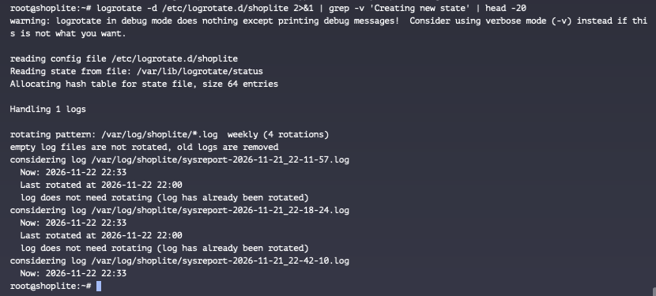

Nothing is due yet because logrotate starts the one-week clock the first time it sees a file (`Last rotated at` is the time of the run), not when the report was created.

### How the rule applies to timestamped files

A normal logrotate rule handles one fixed file (`access.log` → `access.log.1` → `access.log.2.gz` ...), and `rotate 4` is the number of generations. `sysreport.sh` works differently: every run writes a **new, uniquely named** file and never touches it again. So each file is rotated **once**: it is renamed and compressed, and its name never comes round again.

I tested this on a throwaway folder (not the real logs), forcing rotation twice:

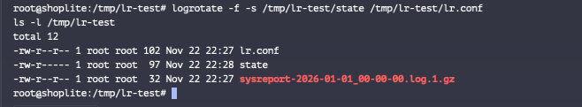

- `sysreport-2026-01-01_00-00-00.log` became `sysreport-2026-01-01_00-00-00.log.1.gz`.
- No new empty `.log` was left behind, because of `nocreate`. The default (`create`) would leave an empty report file next to every rotated one, and nothing ever writes to it.
- The second forced run did nothing to the `.gz`: the `*.log` pattern no longer matches it, and its name is unique, so it is never rotated again and never reaches `.4`.

So for timestamped files, **`rotate 4` never deletes anything**. Logrotate's job here is to compress reports after about a week. Something else has to remove them.

### How it interacts with the 14-day cleanup

The cron cleanup is that something else, and it decides the real retention:

| Age of a report | State |
| --- | --- |
| Day 0 | `sysreport-<date>.log`, plain text |
| About 1 week (logrotate runs once a day and rotates a file a week after it first sees it) | renamed and compressed to `sysreport-<date>.log.1.gz` |
| About 15 days (`find -mtime +14`) | deleted by the 03:15 cleanup |

Two things make this work:

- **The cleanup pattern is `sysreport-*.log*`, not `sysreport-*.log`.** With the plain pattern it would never match the `.log.1.gz` files, and compressed reports would pile up forever, because logrotate does not remove them either. gzip keeps the file's modification time, so a compressed report is still deleted 14 days after it was written.
- **The two never touch the same file at the same moment in a harmful way.** Logrotate runs once a day and the cleanup once a day, at 03:15. Both only ever act on whole files that are no longer being written, so there is nothing to race with.

`rotate 4` (four weeks) is longer than the 14-day cleanup, so in practice the cleanup is what limits retention to about two weeks, and the rotation rule is what saves space during that time.

### Design decisions

- **`nocreate`.** Reports are written once, so a replacement empty file would be pure clutter. Rotated files keep their owner and mode (`root:root`, `rw-r--r--`) because they are renamed, not recreated.
- **`missingok` and `notifempty`.** The directory can legitimately be empty or contain empty files (for example after a failed run), and neither should make logrotate fail or produce empty archives.
- **No `su` line.** `/var/log/shoplite` is owned by root and logrotate runs as root, so no privilege change is needed.
- **A tested claim, not an assumed one.** The timestamped-file behaviour above comes from the forced test on a throwaway folder, not from reading the man page.

## Problems encountered and how I solved them

- **`tom` could not edit a file `ava` created.** The group was correct (`shopops`, thanks to setgid) but the file was `rw-r--r--` because of the default `umask`. Fixed with a default ACL on `/srv/shoplite`.
- **`setfacl: command not found`.** The `acl` package was not installed in the Ubuntu VM image. Fixed with `sudo apt install -y acl`.
- **The default ACL did not change the existing test file.** Default ACLs only apply to files created *after* they are set, so I deleted the old file and created a new one.
- **A confusing test result.** I typed a command with a stray line break, so `cat` tried to read files called `sudo` and `tom`. I re-ran it as two clean commands.
- **`sysreport.sh` claimed "Report saved" when it had not saved anything.** Run without `sudo`, `tee` could not write the file, but the report still printed and the last line said it was saved. Fixed by checking that `/var/log/shoplite` is writable before printing anything.
- **`logscan.sh` stopped with exit 141 on a big log.** `sort | head -n N` under `pipefail` fails when `head` closes the pipe early. A 4-line test log never showed it; a 200,000-line synthetic log did. Fixed by replacing `head` with an `awk 'NR<=n'` stage.
- **The 14-day cleanup would never have deleted compressed reports.** Logrotate renames reports to `.log.1.gz`, which the pattern `sysreport-*.log` does not match. Found while thinking through the logrotate interaction and confirmed with a forced rotation on a throwaway folder. Fixed by widening the cleanup pattern to `sysreport-*.log*`.
- **Getting a real 5xx out of Nginx.** The default site never returns one. My first attempt to add a test route with `sed` did not stick, so the early requests gave a mix of `500` and `404`. A temporary route in the default server block gave a genuine `500`, and I removed it afterwards.
- **`Permission denied` installing the logrotate file.** I ran `install` into `/etc/logrotate.d/` from the `ubuntu` account instead of with `sudo`. Re-ran it with `sudo`.

## What I learnt

- **Users, groups and shared access.** I learnt how to add users, put them in a group, and give only that group read, write and execute access to the organisation's files, so everyone outside the group is locked out.
- **Load average.** While building `sysreport.sh` I learnt what load average means: how many processes are using the CPU or waiting for their turn on it, averaged over the last 1, 5 and 15 minutes.
- **systemctl.** I learnt more about `systemctl`, including how to list active units and failed systemd units.
- **Functions in shell scripts.** I learnt how to organise a `.sh` script into functions, so each part of the report is its own small piece instead of one long block.
